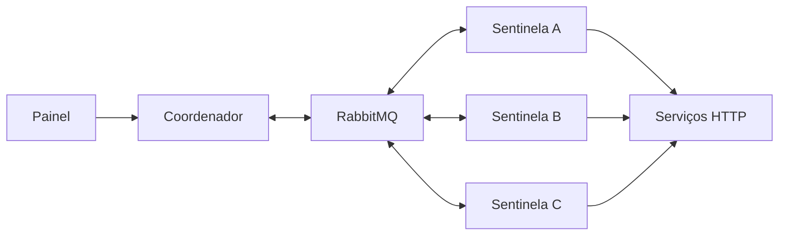

# Arquitetura planejada

Hash consistente com pesos, filas direcionadas por sentinela, ACK manual após confirmação de publicação e persistência, deduplicação por tarefa e rodada, heartbeat a cada 2 s e timeout de 6 s. Sem maioria, manter SUSPEITO. Coordenador e RabbitMQ são pontos únicos de falha nesta proposta.
